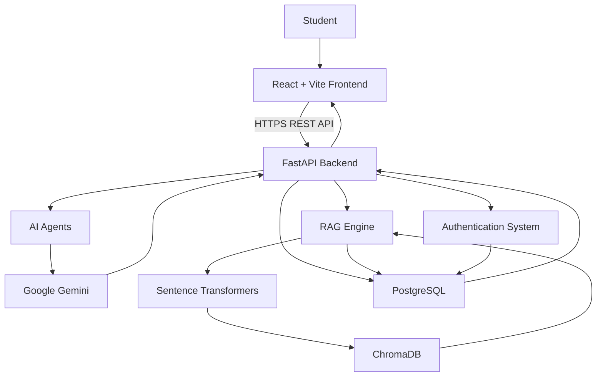

# 🎓 AisynEdu – AI-Powered Intelligent Learning Platform

### Learn. Connect. Evolve.

AisynEdu is a domain-specific Generative AI education platform designed to transform the learning experience through Large Language Models (LLMs), Retrieval-Augmented Generation (RAG), and intelligent AI-powered learning tools.

The platform provides an interactive environment where students can ask questions, understand complex concepts, upload learning materials, generate revision notes, and practice through AI-generated quizzes.

**Live Application:** https://aisynedu.vercel.app  
**GitHub Repository:** https://github.com/nandhini-127/AisynEdu  
**Demo Video:** https://rb.gy/fkdqe1

---

## 📌 1. Project Overview

Traditional learning platforms often provide static educational content without personalized explanations or interactive learning support.

AisynEdu addresses this challenge through an intelligent AI-powered learning assistant that combines conversational AI, document-based knowledge retrieval, and automated educational content generation.

The platform is designed to provide context-aware responses, support document-based learning, and help students improve their understanding through personalized learning experiences.

## 🎯 2. Project Objectives

- Develop a production-oriented Generative AI application using LLMs.
- Implement a Retrieval-Augmented Generation (RAG) pipeline.
- Enable users to interact with uploaded educational documents.
- Provide conversational AI assistance for learning.
- Generate quizzes and structured revision notes.
- Support secure user authentication.
- Maintain relevant conversational context.
- Provide an interactive analytics dashboard.
- Deploy the application using cloud infrastructure.

## ✨ 3. Key Features

### 🤖 AI Tutor
- Interactive AI-powered educational assistant.
- Natural-language question answering.
- Concept explanations and learning support.
- Context-aware conversational interactions.

### 📚 Document Library and RAG
- Upload educational PDF materials.
- Extract and process document content.
- Split documents into smaller text chunks.
- Generate vector embeddings.
- Store and retrieve relevant chunks using ChromaDB.
- Generate document-grounded answers with citations.

### 📝 AI Study Notes
- Generate structured revision notes.
- Organize important concepts and definitions.
- Support topic-based learning and revision.

### 🧠 AI Quiz Center
- Generate multiple-choice questions.
- Provide answer options.
- Support interactive learning and knowledge assessment.

### 💬 Conversational Memory
- Support conversational context across interactions.
- Enable follow-up questions within supported conversations.

### 📊 Analytics Dashboard
- Provide a centralized learning dashboard.
- Display available user activity and usage information.

### 🔐 Authentication
- User registration and login.
- Protected application features.
- User-specific data access.

### 🖼️ Multimodal Learning
- Document-based learning through PDF uploads.
- Image input and processing capabilities where supported by the configured application workflow.

### 🛡️ Safety and Reliability
- Input validation.
- Error handling.
- Controlled AI generation and fallback handling.

---

## 🏗️ 4. System Architecture

AisynEdu follows a frontend-backend architecture with dedicated database and vector storage services.



### Deployment Architecture

| Component | Platform |
|---|---|
| Frontend | Vercel |
| Backend | Railway |
| Relational database | PostgreSQL |
| Vector database | ChromaDB |
| LLM | Google Gemini |
| Embedding model | Sentence Transformers |
| Containerization | Docker and Docker Compose |
| Source control | GitHub |

---

## 🧠 5. Retrieval-Augmented Generation (RAG) Pipeline

AisynEdu uses RAG to enable question answering based on uploaded educational documents.

### Document Ingestion

1. User uploads a PDF document.
2. Backend extracts text from the document.
3. Extracted content is divided into smaller chunks.
4. An embedding model converts chunks into numerical vectors.
5. Embeddings and associated metadata are stored in ChromaDB.
6. Document information is maintained in PostgreSQL.

### Retrieval and Generation

1. User submits a question.
2. The question is converted into an embedding.
3. ChromaDB searches for semantically relevant document chunks.
4. Retrieved chunks are used to construct contextual information.
5. The LLM generates an answer using the retrieved context.
6. Relevant document citations are returned with the response.

### RAG Technology Stack

- Vector database: ChromaDB
- Embedding model: `all-MiniLM-L6-v2`
- LLM: Google Gemini
- Backend framework: FastAPI

---

## 🛠️ 6. Technology Stack

| Category | Technologies |
|---|---|
| Frontend | React, TypeScript, Vite |
| Styling | Tailwind CSS |
| Backend | Python, FastAPI |
| LLM | Google Gemini |
| RAG | Retrieval-Augmented Generation |
| Embeddings | Sentence Transformers |
| Vector Database | ChromaDB |
| Database | PostgreSQL |
| Authentication | Application authentication system |
| Containerization | Docker, Docker Compose |
| Deployment | Vercel, Railway |
| Version Control | Git, GitHub |

---

## 📂 7. Project Structure

```text
AisynEdu/
│
├── backend/
│   ├── app/
│   │   ├── agents/
│   │   ├── core/
│   │   ├── rag/
│   │   ├── api/
│   │   └── ...
│   ├── tests/
│   ├── requirements.txt
│   └── Dockerfile
│
├── frontend/
│   ├── src/
│   ├── public/
│   ├── package.json
│   └── ...
│
├── docs/
│   ├── demo
│      ├── aisynedu-demo.mp4
│
├── docker-compose.yml
├── docker-compose.prod.yml
├── README.md
└── .gitignore
```

*The structure above is an overview. Refer to the repository for the complete directory structure.*

---

## ⚙️ 8. Local Installation and Setup

### Prerequisites

- Python 3.10 or a compatible project-supported version.
- Node.js and npm.
- PostgreSQL.
- ChromaDB.
- Google Gemini API key.

### Step 1: Clone the Repository

```bash
git clone https://github.com/nandhini-127/AisynEdu.git

cd AisynEdu
```

### Step 2: Backend Setup

```bash
cd backend

python -m venv venv
```

Activate the virtual environment.

Windows:

```powershell
venv\Scripts\activate
```

Install dependencies:

```bash
pip install -r requirements.txt
```

Configure the required backend environment variables using the project's configuration.

Start the backend using the configured FastAPI entry point.

### Step 3: Frontend Setup

Open another terminal:

```bash
cd frontend

npm install

npm run dev
```

### Step 4: Production Build

```bash
npm run build
```

---

## 🐳 9. Docker Deployment

AisynEdu supports containerized deployment using Docker and Docker Compose.

Docker simplifies application setup by running the configured application services in containers.

### Prerequisites

- Docker Desktop
- Docker Compose
- Required environment variables

### Step 1: Clone the Repository

```bash
git clone https://github.com/nandhini-127/AisynEdu.git

cd AisynEdu
```

### Step 2: Configure Environment Variables

Configure the required environment variables according to the project's configuration.

Ensure that API keys, database credentials, authentication secrets, and other sensitive values are kept in local environment files and are not committed to GitHub.

### Step 3: Build and Start Containers

```bash
docker compose up --build -d
```

### Step 4: Check Running Containers

```bash
docker compose ps
```

### Step 5: View Application Logs

```bash
docker compose logs -f
```

### Step 6: Stop the Application

```bash
docker compose down
```

**Note:** Use the Docker Compose configuration and environment variables provided by the repository. Persistent database and vector-storage volumes should be configured appropriately to preserve application data.

For production-specific container configuration, refer to `docker-compose.prod.yml` and `docs/DEPLOYMENT.md`.

---

## 🔑 10. Environment Configuration

Configure environment variables through local environment files or your cloud deployment settings.

Example variable names:

```env
DATABASE_URL=
SYNC_DATABASE_URL=

GOOGLE_API_KEY=
GEMINI_MODEL=

CHROMA_MODE=http
CHROMA_HOST=
CHROMA_PORT=

SECRET_KEY=
ENVIRONMENT=development

UPLOAD_DIR=
IMAGE_UPLOAD_DIR=
```

**Security:** Never commit actual API keys, database credentials, authentication secrets, or production environment files to GitHub.

Refer to the project's configuration for the complete list of required environment variables.

---

## ☁️ 11. Cloud Deployment

AisynEdu uses separate cloud services for frontend and backend deployment.

### Frontend – Vercel

1. Connect the GitHub repository to Vercel.
2. Configure the root directory as `frontend`.
3. Select Vite as the framework.
4. Configure the production API URL.
5. Deploy the frontend.

### Backend – Railway

1. Connect the GitHub repository to Railway.
2. Configure the backend service and Dockerfile.
3. Add the required production environment variables.
4. Configure PostgreSQL and ChromaDB services.
5. Deploy the FastAPI application.

### Live Deployment

- **Frontend:** https://aisynedu.vercel.app
- **Backend:** https://aisynedu-production-7dd9abd6.up.railway.app

---

## 🛡️ 12. Security and Reliability

The application incorporates security and reliability considerations such as:

- Secure handling of API credentials.
- Authentication and user-specific access.
- Environment-based configuration.
- Backend request validation.
- CORS configuration.
- Error handling for external AI services.
- Document access isolation.
- Controlled fallback behavior.

---

## 🧪 13. Testing and Validation

The application should be validated using the following test scenarios:

| Test Scenario | Expected Result |
|---|---|
| User registration | Account created successfully |
| User login | Authenticated session |
| PDF upload | Document uploaded successfully |
| Document indexing | Chunks stored in vector database |
| RAG query | Context-relevant answer |
| AI Tutor | Relevant educational explanation |
| Quiz generation | Valid topic-specific questions |
| Study Notes | Relevant revision material |
| Analytics | User activity displayed |
| Docker deployment | Configured containers start successfully |
| Production deployment | Application accessible online |

---

## 🎥 14. Project Demonstration

A video demonstration will showcase:

- Application overview.
- User authentication.
- AI Tutor interaction.
- PDF upload and RAG question answering.
- Quiz generation.
- Study Notes synthesis.
- Analytics dashboard.
- Docker-based application execution.
- Cloud deployment.

**Demo Video:** https://rb.gy/fkdqe1

---

## 🚀 15. Future Enhancements

- Advanced multimodal question answering.
- Improved long-term conversational memory.
- Enhanced AI guardrails and response validation.
- More sophisticated multi-agent workflows.
- Personalized learning recommendations.
- Expanded analytics and performance monitoring.
- Improved response latency and generation reliability.

---

## 👩‍💻 16. Author

**Nandhini S S**

B.Tech – Artificial Intelligence and Data Science

**Project:** AisynEdu – AI-Powered Intelligent Learning Platform

**GitHub:** https://github.com/nandhini-127

---

## 📄 17. License

This project is intended for educational and demonstration purposes.

---

### AisynEdu – Learn. Connect. Evolve.

*Making learning more interactive, intelligent, and accessible through Generative AI.*
