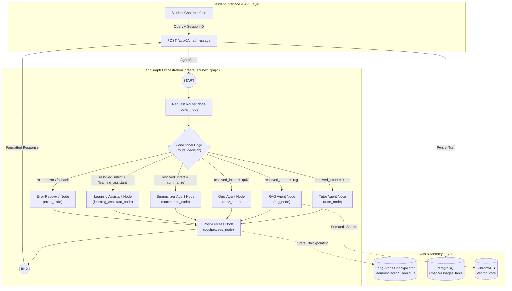

# EduNex AI — Agent Architecture & LangGraph Orchestration Specification

**Document Version:** 1.0.0  
**Status:** Approved & Verified  
**System Scope:** EduNex AI Backend (`app/agents`, `app/rag`, `app/memory`, `app/api/routes/chat.py`)

---

## 1. Executive Summary & Vision

EduNex AI provides a unified, production-grade conversational educational platform powered by an intelligent multi-agent orchestration architecture. Instead of relying on a monolithic prompt or single static system message, EduNex AI implements **LangGraph (0.2+)** to coordinate five specialized agents under a single, unified chat interface:

1. **Tutor Agent**: Pedagogical conceptual breakdown with multi-tier difficulty adaptation (`beginner`, `intermediate`, `advanced`), concrete analogies, and real-world engineering/scientific applications.
2. **RAG Agent**: Document-grounded retrieval from uploaded study materials, generating verified source citations (`[Document: <name>, Page: <page>]`) and explicitly differentiating between document-grounded answers and general knowledge fallbacks.
3. **Quiz Agent**: Automated MCQ assessment generation producing 4 distinct options (A–D), isolating correct answers, providing pedagogical post-submission explanations, and supporting variable difficulty levels.
4. **Summarization Agent**: Comprehensive academic synthesis producing high-level overviews, bulleted core concepts, rigorous definitions dictionaries, and examination revision notes.
5. **Personalized Learning Assistant**: Longitudinal conversation trajectory analysis, tracking discussed subjects, identifying topics the student struggled with or marked to revisit, and providing actionable study tips.

---

## 2. Multi-Agent Orchestration Architecture

The orchestration engine coordinates student requests using a **Directed Cyclic/Acyclic StateGraph** with conditional routing, thread checkpointing, loop prevention, and fail-fast provider guarantees.



---

## 3. LangGraph State Schema & Data Contracts

The central workflow state is represented by the typed dictionary `AgentState`, featuring LangChain message aggregation and structured payloads for specialized agent responses.

```python
class AgentState(TypedDict, total=False):
    # User & Session Context
    user_id: str
    session_id: str
    subject: str

    # Conversational Messages (appends using add_messages reducer)
    messages: Annotated[List[BaseMessage], add_messages]

    # User Query & Parameters
    input_query: str
    requested_intent: str       # "auto" | "tutor" | "rag" | "quiz" | "summarize" | "learning_assistant"
    difficulty: str             # "beginner" | "intermediate" | "advanced"
    document_ids: List[str]     # Scoped documents for RAG, Quizzes, or Summarization

    # Model & Provider Configuration
    llm_provider: str           # "gemini" | "ollama"
    model_name: str

    # Router Resolution
    resolved_intent: str        # "tutor" | "rag" | "quiz" | "summarize" | "learning_assistant"
    router_reasoning: str

    # Context & Grounding
    retrieved_chunks: List[Dict[str, Any]]
    context_text: str
    is_document_grounded: bool   # True if grounded in docs, False if general knowledge

    # Generated Output
    response_text: str
    citations: List[SourceCitationDict]

    # Specialized Agent Payloads
    quiz_data: List[QuizQuestionDict]
    summary_data: SummaryDataDict
    learning_recommendations: List[str]
    tracked_topics: List[str]

    # Loop Prevention & Observability
    iteration_count: int
    max_iterations: int
    latency_ms: int
    error: Optional[str]
```

### Specialized Payloads

1. **SourceCitationDict**:
   - `document_id`: UUID string of the ingested document.
   - `document_name`: Filename of the source PDF.
   - `page`: 1-based page number.
   - `chunk_index`: Sequence position within the document.
   - `score`: Cosine similarity score.
   - `text_snippet`: Verbatim chunk excerpt.

2. **QuizQuestionDict**:
   - `id`: Question index.
   - `question`: Clear educational problem stem.
   - `options`: Array of exactly 4 choices (`["A) ...", "B) ...", "C) ...", "D) ..."]`).
   - `correct_answer`: Answer key (`"A" | "B" | "C" | "D"`).
   - `explanation`: Thorough rationale explaining why the correct choice is valid and others are incorrect.
   - `difficulty`: Target academic rigor.

3. **SummaryDataDict**:
   - `overview`: High-level chapter synopsis.
   - `key_points`: List of atomic educational takeaways.
   - `definitions`: Terminology dictionary mapping concepts to clear definitions.
   - `revision_notes`: Quick review bullet points for examination prep.

---

## 4. Specialized Agent Capabilities

### 4.1 Tutor Agent (`app/agents/tutor_agent.py`)
- **Mission**: Deconstruct concepts into intuitive mental models tailored to student proficiency.
- **Difficulty Modes**:
  - `beginner`: Plain language, intuitive physical metaphors, step-by-step sequential reasoning, no heavy mathematical jargon.
  - `intermediate`: Standard undergraduate terminology, formal definitions, architectural diagrams, balanced technical depth.
  - `advanced`: Rigorous mathematical formulations, asymptotic complexity, trade-off analyses, failure modes, and low-level edge cases.
- **Standard Structural Format**:
  1. Core Concept Overview.
  2. Concrete Real-World Analogy.
  3. Step-by-Step Mechanism / Breakdown.
  4. Industry & Practical Applications.
  5. Concept Check Question.

### 4.2 RAG Agent (`app/agents/rag_agent.py`)
- **Mission**: Grounded question answering based on the student's uploaded textbooks, lecture slides, and notes.
- **Grounding Protocol**:
  - Queries `ChromaVectorStore` isolated by `user_id` and optional `document_ids`.
  - If chunks exceed similarity thresholds:
    - Banners response with `**[Document-Grounded Answer]**`.
    - Enforces citation format `[Document: <filename>, Page: <page>]`.
    - Generates typed citations list.
  - If no chunks match or documents are empty:
    - Sets `is_document_grounded = False`.
    - Prefaces output with `**[General Knowledge Response]**` banner and informs student that uploaded materials do not cover the topic.

### 4.3 Quiz Agent (`app/agents/quiz_agent.py`)
- **Mission**: Dynamic formative assessment generator.
- **Design Safeguards**:
  - Forces strict JSON extraction containing problem stems, options, correct answers, and explanations.
  - Hides the answer key under a Markdown spoiler tag (`<details><summary>💡 Click to reveal Answer & Explanation</summary>...</details>`) so students can test themselves interactively without immediate spoilers.
  - Generates exactly 4 plausible options without ambiguous or overlapping answers.

### 4.4 Summarization Agent (`app/agents/summarizer_agent.py`)
- **Mission**: Extract and structure academic knowledge into efficient study guides.
- **Outputs**:
  - Executive summary overview.
  - Core takeaways list.
  - Key definitions dictionary.
  - High-yield revision points.

### 4.5 Personalized Learning Assistant (`app/agents/learning_assistant.py`)
- **Mission**: Cognitive study companion tracking student knowledge progression.
- **Capabilities**:
  - Evaluates recent chat turns to extract mastered vs. challenging topics.
  - Synthesizes personalized next-step learning recommendations.
  - Suggests specific practice questions and foundational reviews.

---

## 5. Intelligent Request Routing

The `RequestRouter` (`app/agents/router.py`) handles dispatching through a 3-tier cascade:

1. **Explicit Intent Override**: If the user or UI provides an explicit intent (`"tutor"`, `"rag"`, `"quiz"`, `"summarize"`, `"learning_assistant"`), the router bypasses classification and routes directly.
2. **High-Precision Fast Path (Regex/Heuristic)**:
   - *Quiz*: Keywords like `"quiz"`, `"mcq"`, `"test me"`, `"practice question"`.
   - *Summarize*: Keywords like `"summarize"`, `"summary"`, `"revision notes"`, `"tldr"`.
   - *Learning Assistant*: Keywords like `"what should i study"`, `"my progress"`, `"learning recommendations"`, `"topics to revisit"`.
   - *RAG*: Keywords like `"in my document"`, `"from the pdf"`, `"uploaded notes"`, or when `document_ids` are explicitly passed.
3. **LLM Semantic Classification**: Queries the model with `ROUTER_SYSTEM_PROMPT` to classify ambiguous queries into one of the 5 canonical agents with brief reasoning.

---

## 6. Conversational Memory & State Bounding

EduNex AI combines session-bounded context with persistent storage:

- **PostgreSQL Persistence**: Every student turn and assistant reply is persisted to the `messages` table with role, session ID, latency, and rich metadata (`quiz_data`, `summary_data`, `recommendations`, `citations`).
- **Bounded Context Window**: The `ConversationMemoryManager` retrieves the last $N$ turns (default 10 messages) to prevent context window overflow while preserving conversational coherence.
- **Student Privacy & History Reset**: An explicit endpoint (`DELETE /api/v1/chat/sessions/{session_id}/messages`) allows students to clear conversation history at any time.

---

## 7. LLM Provider Fail-Fast Policy

To ensure deterministic reliability and adhere strictly to user configuration:

> [!IMPORTANT]
> **Provider Fail-Fast Rule**: *EduNex AI never silently changes providers when a request fails.*
> 
> - If `gemini` is selected and credentials/quota fail, the system raises `ProviderUnavailableError` (HTTP 503) instead of silently routing to Ollama.
> - If `ollama` is selected and the local daemon is unreachable or the model is missing, the system raises `ProviderUnavailableError` with diagnostic hints instead of silently falling back to Gemini.
> - When running offline without external cloud credentials, the internal deterministic offline mock engine provides structured educational responses so automated CI/CD and unit tests execute consistently.

---

## 8. Multi-Routing Verification: Same Query to 5 Capabilities

To demonstrate that the same educational query can be routed to each specialized capability, the test suite executes the query:
> *"What is the Transmission Control Protocol (TCP) three-way handshake?"*

Across all five capabilities:
- **Tutor**: Breaks down SYN, SYN-ACK, ACK with a phone call analogy and connection states.
- **RAG**: Retrieves passages from `computer_networks.pdf` and outputs citations with page numbers.
- **Quiz**: Generates 4-option MCQs with answer keys and hidden spoiler explanations.
- **Summarize**: Produces an executive summary, definitions for SYN/ACK, and revision notes.
- **Learning Assistant**: Analyzes previous session turns and generates a personalized study roadmap.

