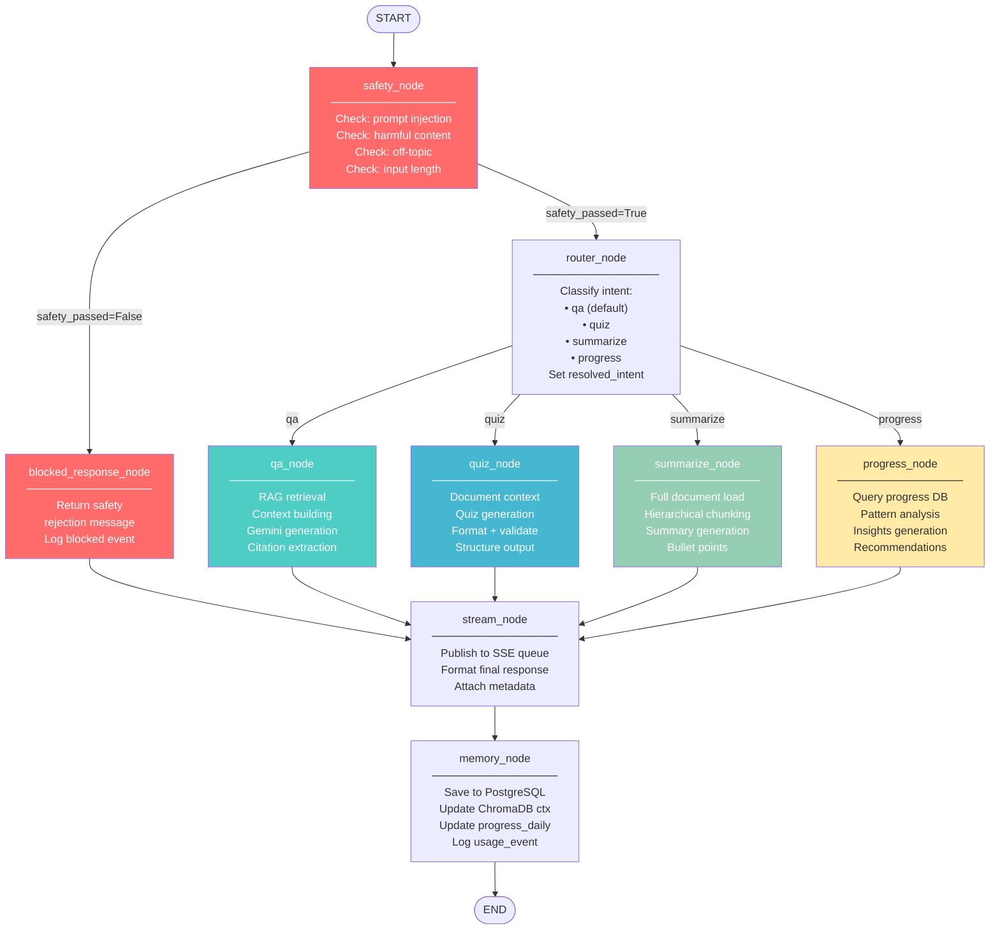
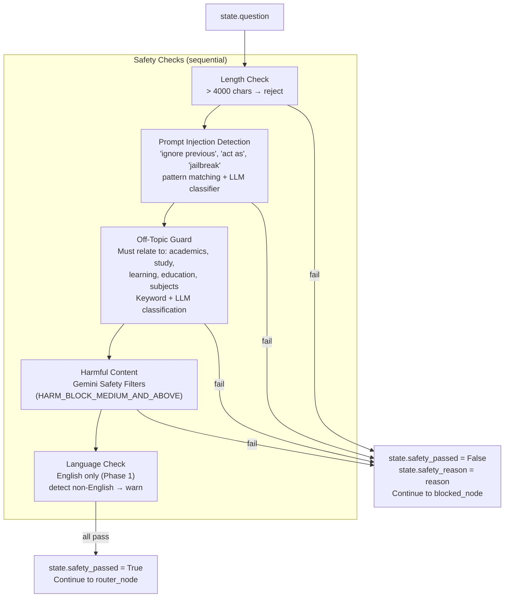
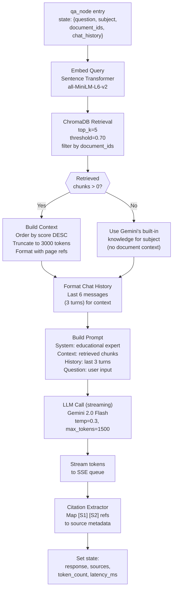
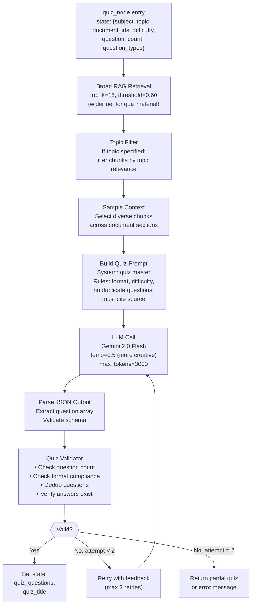
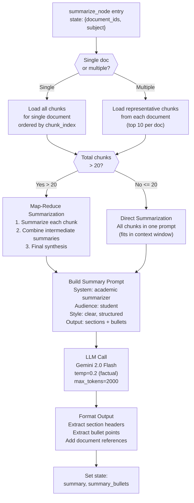
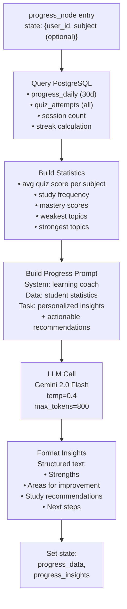
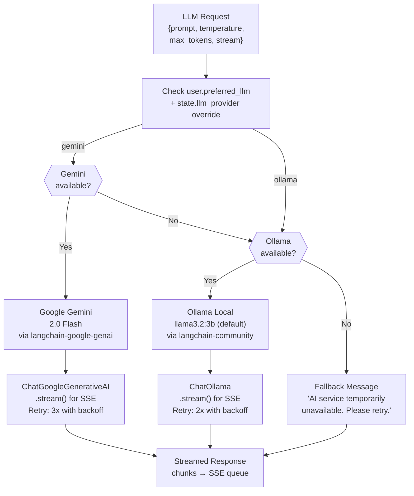
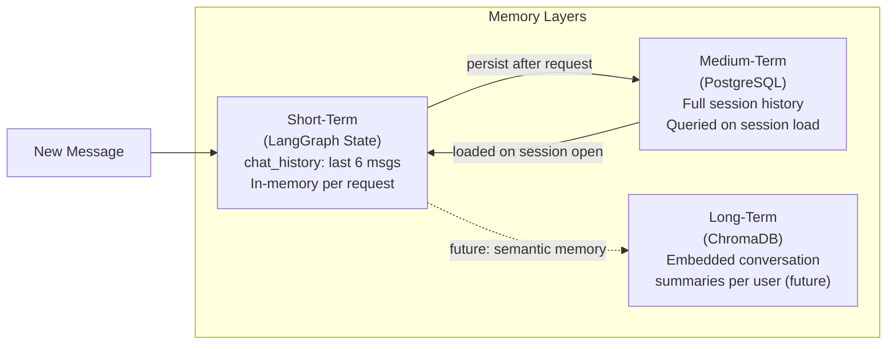
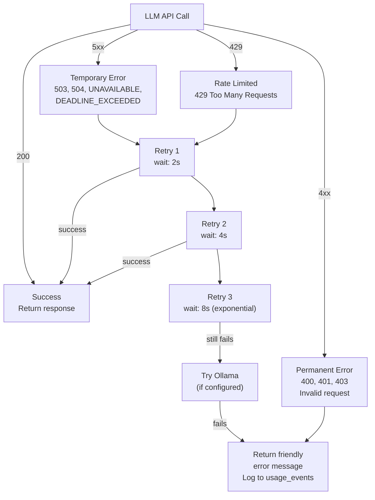

# EduNex AI — Agent Workflow Design

> **Version:** 1.0  
> **Date:** 2026-11-12  
> **Framework:** LangGraph 0.2+ (StateGraph)  
> **LLM:** Google Gemini 2.0 Flash (primary) + Ollama (optional)

---

## Table of Contents
1. [Agent Overview](#1-agent-overview)
2. [LangGraph State Definition](#2-langgraph-state-definition)
3. [Master Orchestration Workflow](#3-master-orchestration-workflow)
4. [Safety Guardrail Agent](#4-safety-guardrail-agent)
5. [Q&A Agent Workflow](#5-qa-agent-workflow)
6. [Quiz Generation Agent Workflow](#6-quiz-generation-agent-workflow)
7. [Summarization Agent Workflow](#7-summarization-agent-workflow)
8. [Progress Insights Agent Workflow](#8-progress-insights-agent-workflow)
9. [LLM Provider Router](#9-llm-provider-router)
10. [Memory & Context Management](#10-memory--context-management)
11. [System Prompt Templates](#11-system-prompt-templates)
12. [Error Handling & Retry Strategy](#12-error-handling--retry-strategy)
13. [Agent File Structure](#13-agent-file-structure)

---

## 1. Agent Overview

EduNex AI uses **5 specialized agents** orchestrated by LangGraph:

| Agent | File | Responsibility |
|-------|------|---------------|
| **Safety Guardrail** | `safety_agent.py` | Block unsafe inputs before any LLM call |
| **Router** | `orchestrator.py` | Classify intent, route to appropriate agent |
| **Q&A Agent** | `qa_agent.py` | Answer questions using RAG + conversational memory |
| **Quiz Agent** | `quiz_agent.py` | Generate structured quiz questions from documents |
| **Summarizer Agent** | `summarizer_agent.py` | Create hierarchical summaries of documents |
| **Progress Agent** | `progress_agent.py` | Analyze learning data and generate personalized insights |

### Design Principles
1. **Safety First** — Every input passes through the guardrail before reaching any LLM
2. **RAG-Augmented** — All educational responses are grounded in uploaded documents
3. **Stateful** — LangGraph state persists across agent nodes in a single invocation
4. **Streamable** — All LLM calls use streaming mode; tokens are queued for SSE
5. **Idempotent** — Failed nodes can be retried without corrupting state
6. **Observable** — Every node logs entry/exit, latency, and token count

---

## 2. LangGraph State Definition

```python
# agents/state.py

from typing import TypedDict, Optional, Annotated
from langchain_core.messages import BaseMessage
from langgraph.graph.message import add_messages


class SourceCitation(TypedDict):
    title: str
    page: Optional[int]
    score: float
    snippet: str
    doc_id: str


class QuizQuestion(TypedDict):
    id: int
    type: str           # "mcq" | "true_false" | "fill_blank"
    question: str
    options: Optional[list[str]]
    answer: str | bool
    explanation: str
    source_chunk: Optional[str]


class EduNexState(TypedDict, total=False):
    # ── Input (set by ChatService before invoking) ──────────────────
    user_id: str
    session_id: str
    message_id: str           # SSE queue key
    subject: str              # e.g. "Mathematics"
    question: str             # Raw user input
    intent: str               # "auto"|"qa"|"quiz"|"summarize"|"progress"
    document_ids: list[str]   # Docs to scope RAG to
    llm_provider: str         # "gemini" | "ollama"
    model_name: str

    # ── Safety ──────────────────────────────────────────────────────
    safety_passed: bool
    safety_reason: str        # Populated if blocked

    # ── Routing ─────────────────────────────────────────────────────
    resolved_intent: str      # After auto-classification
    routing_confidence: float

    # ── RAG ─────────────────────────────────────────────────────────
    retrieved_chunks: list[dict]
    context: str              # Merged context for prompt
    sources: list[SourceCitation]

    # ── Q&A Output ──────────────────────────────────────────────────
    response: str             # Final answer text

    # ── Quiz Output ─────────────────────────────────────────────────
    quiz_questions: list[QuizQuestion]
    quiz_title: str

    # ── Summary Output ──────────────────────────────────────────────
    summary: str
    summary_bullets: list[str]

    # ── Progress Output ─────────────────────────────────────────────
    progress_data: dict
    progress_insights: str

    # ── Conversation Memory ─────────────────────────────────────────
    # Annotated with add_messages reducer for LangGraph message accumulation
    chat_history: Annotated[list[BaseMessage], add_messages]

    # ── Telemetry ───────────────────────────────────────────────────
    total_token_count: int
    total_latency_ms: int
    node_trace: list[str]     # Ordered list of nodes visited
```

---

## 3. Master Orchestration Workflow



### Graph Build Code Pattern

```python
# agents/orchestrator.py

from langgraph.graph import StateGraph, START, END
from .state import EduNexState
from .safety_agent import safety_node, blocked_response_node
from .qa_agent import qa_node
from .quiz_agent import quiz_node
from .summarizer_agent import summarize_node
from .progress_agent import progress_node
from .stream_node import stream_node
from .memory_node import memory_node


def should_continue(state: EduNexState) -> str:
    """Conditional edge: route after safety check."""
    if not state.get("safety_passed", True):
        return "blocked"
    return "route"


def route_intent(state: EduNexState) -> str:
    """Conditional edge: route after intent classification."""
    return state.get("resolved_intent", "qa")


def build_graph() -> StateGraph:
    workflow = StateGraph(EduNexState)

    # Register nodes
    workflow.add_node("safety",    safety_node)
    workflow.add_node("router",    router_node)
    workflow.add_node("blocked",   blocked_response_node)
    workflow.add_node("qa",        qa_node)
    workflow.add_node("quiz",      quiz_node)
    workflow.add_node("summarize", summarize_node)
    workflow.add_node("progress",  progress_node)
    workflow.add_node("stream",    stream_node)
    workflow.add_node("memory",    memory_node)

    # Edges
    workflow.add_edge(START, "safety")
    workflow.add_conditional_edges("safety", should_continue,
        {"blocked": "blocked", "route": "router"})
    workflow.add_conditional_edges("router", route_intent,
        {"qa": "qa", "quiz": "quiz", "summarize": "summarize", "progress": "progress"})
    workflow.add_edge("blocked",   "stream")
    workflow.add_edge("qa",        "stream")
    workflow.add_edge("quiz",      "stream")
    workflow.add_edge("summarize", "stream")
    workflow.add_edge("progress",  "stream")
    workflow.add_edge("stream",    "memory")
    workflow.add_edge("memory",    END)

    return workflow.compile()


edunex_graph = build_graph()
```

---

## 4. Safety Guardrail Agent



**Safety Rejection Messages:**

| Reason | User Message |
|--------|-------------|
| `too_long` | "Your message is too long. Please keep it under 4000 characters." |
| `prompt_injection` | "I detected an attempt to manipulate my instructions. I'm here to help with studies only." |
| `off_topic` | "I'm EduNex AI, your educational assistant. I can only help with academic subjects and studying." |
| `harmful_content` | "I can't respond to that content. Please ask an educational question." |
| `unsupported_language` | "Please ask your question in English. Multi-language support is coming soon." |

---

## 5. Q&A Agent Workflow



---

## 6. Quiz Generation Agent Workflow



**Quiz JSON Format requested from LLM:**
```json
{
  "title": "Thermodynamics — Medium Quiz",
  "questions": [
    {
      "id": 1,
      "type": "mcq",
      "question": "Which law of thermodynamics...",
      "options": ["Option A", "Option B", "Option C", "Option D"],
      "answer": "Option B",
      "explanation": "Because...",
      "source_chunk": "Chapter 4, page 12"
    }
  ]
}
```

---

## 7. Summarization Agent Workflow



---

## 8. Progress Insights Agent Workflow



---

## 9. LLM Provider Router



**LLM Service Code Pattern:**

```python
# services/llm_service.py

from langchain_google_genai import ChatGoogleGenerativeAI
from langchain_community.chat_models import ChatOllama

class LLMService:
    def get_llm(self, provider: str, streaming: bool = True):
        if provider == "gemini":
            return ChatGoogleGenerativeAI(
                model=settings.GEMINI_MODEL,       # "gemini-2.0-flash"
                google_api_key=settings.GOOGLE_API_KEY,
                temperature=0.3,
                max_retries=3,
                streaming=streaming,
            )
        elif provider == "ollama":
            return ChatOllama(
                base_url=settings.OLLAMA_BASE_URL,
                model=settings.OLLAMA_MODEL,       # "llama3.2"
                temperature=0.3,
                streaming=streaming,
            )
        raise ValueError(f"Unknown provider: {provider}")
```

---

## 10. Memory & Context Management

### Conversation Memory Strategy



### History Loading Strategy

```python
# services/chat_service.py

async def load_chat_history(session_id: UUID, limit: int = 6) -> list[BaseMessage]:
    """Load last N messages as LangChain BaseMessage objects."""
    messages = await message_repo.get_recent(session_id, limit=limit)
    history = []
    for msg in messages:
        if msg.role == "user":
            history.append(HumanMessage(content=msg.content))
        else:
            history.append(AIMessage(content=msg.content))
    return history
```

---

## 11. System Prompt Templates

### Q&A System Prompt

```python
QA_SYSTEM_PROMPT = """
You are EduNex AI, a personalized educational assistant for students.

Your role:
- Answer the student's question clearly and accurately
- Use the provided document context as your primary source
- Reference sources as [S1], [S2], etc. where applicable
- If the context doesn't contain the answer, use your general knowledge
  but clearly state: "This is from my general knowledge, not your documents."
- Adapt your explanation to be appropriate for a student studying {subject}
- Use examples, analogies, and step-by-step breakdowns when helpful
- Format responses with Markdown (headers, bold, bullet points, code blocks)

Rules:
- Never fabricate facts or citations
- Never hallucinate page numbers you don't have
- If unsure, say so and suggest the student verify
- Keep responses focused and educational
- Do not engage with off-topic requests

Document Context:
{context}

Conversation History:
{chat_history}
"""
```

### Quiz System Prompt

```python
QUIZ_SYSTEM_PROMPT = """
You are EduNex AI Quiz Master. Generate a high-quality educational quiz.

Requirements:
- Subject: {subject}
- Topic: {topic}
- Difficulty: {difficulty} (easy=recall, medium=understanding, hard=application/analysis)
- Question count: {question_count}
- Question types: {question_types}
- Base all questions on the provided document context
- Each question must have a clear, unambiguous answer
- Explanations must reference the source material

Output ONLY valid JSON in this exact schema:
{{
  "title": "Quiz title",
  "questions": [
    {{
      "id": 1,
      "type": "mcq",
      "question": "Question text?",
      "options": ["A", "B", "C", "D"],
      "answer": "B",
      "explanation": "Because...",
      "source_chunk": "Document section reference"
    }}
  ]
}}

Document Context:
{context}
"""
```

### Summarization System Prompt

```python
SUMMARY_SYSTEM_PROMPT = """
You are EduNex AI, creating a study summary for a student.

Subject: {subject}
Document: {document_title}

Create a clear, structured study summary that:
1. Identifies the main topic and purpose
2. Organizes key concepts into logical sections
3. Highlights important definitions, formulas, and facts
4. Uses bullet points for easy review
5. Notes any relationships between concepts
6. Ends with 5-7 key takeaways for exam preparation

Format:
## Overview
## Key Concepts
### [Concept 1]
### [Concept 2]
## Important Formulas / Definitions
## Key Takeaways
- •
- •

Keep language clear and appropriate for a student studying {subject}.
"""
```

---

## 12. Error Handling & Retry Strategy



**Retry Decorator:**
```python
# utils/retry.py

from tenacity import (
    retry, stop_after_attempt, wait_exponential,
    retry_if_exception_type, before_sleep_log
)

RETRYABLE_ERRORS = (
    "503", "504", "UNAVAILABLE", "DEADLINE_EXCEEDED", "429"
)

def is_retryable(exception: Exception) -> bool:
    return any(code in str(exception) for code in RETRYABLE_ERRORS)

llm_retry = retry(
    retry=retry_if_exception_type(Exception) & is_retryable,
    stop=stop_after_attempt(3),
    wait=wait_exponential(multiplier=1, min=2, max=10),
    before_sleep=before_sleep_log(logger, logging.WARNING),
    reraise=True,
)
```

---

## 13. Agent File Structure

```
backend/app/agents/
├── __init__.py
├── state.py                   # EduNexState TypedDict definition
├── orchestrator.py            # LangGraph build_graph(), edunex_graph
├── safety_agent.py            # safety_node(), blocked_response_node()
├── router_node.py             # router_node() — intent classification
├── qa_agent.py                # qa_node() — RAG-augmented Q&A
├── quiz_agent.py              # quiz_node() — quiz generation
├── summarizer_agent.py        # summarize_node() — document summary
├── progress_agent.py          # progress_node() — learning insights
├── stream_node.py             # stream_node() — SSE publisher
├── memory_node.py             # memory_node() — DB persistence
└── prompts/
    ├── __init__.py
    ├── qa_prompts.py          # QA_SYSTEM_PROMPT, QA_USER_TEMPLATE
    ├── quiz_prompts.py        # QUIZ_SYSTEM_PROMPT
    ├── summary_prompts.py     # SUMMARY_SYSTEM_PROMPT
    ├── progress_prompts.py    # PROGRESS_SYSTEM_PROMPT
    └── safety_prompts.py     # SAFETY_CLASSIFIER_PROMPT

backend/app/rag/
├── __init__.py
├── loader.py                  # PDF, image, text document loaders
├── chunker.py                 # RecursiveCharacterTextSplitter config
├── embedder.py                # SentenceTransformer wrapper + batch embed
├── vectorstore.py             # ChromaDB client + collection management
└── retriever.py               # Query, filter, threshold, format chunks
```

### Key Design Rules for All Agent Nodes

1. **Every node is a pure function:** `(state: EduNexState) → dict`
2. **Return only the keys being updated** — LangGraph merges into state
3. **Never mutate the input state dict** — treat it as immutable
4. **Always append to `node_trace`** — for debugging and observability
5. **Stream tokens via `asyncio.Queue`** — never block waiting for full response
6. **Log latency and token count** — update `total_latency_ms`, `total_token_count`

```python
# Template for every agent node
async def qa_node(state: EduNexState) -> dict:
    start_ms = time.monotonic() * 1000
    logger.info(f"[qa_node] entry | session={state['session_id']}")

    # ... node logic ...

    latency = int(time.monotonic() * 1000 - start_ms)
    logger.info(f"[qa_node] exit | latency={latency}ms | tokens={tokens}")

    return {
        "response": response_text,
        "sources": citations,
        "total_token_count": state.get("total_token_count", 0) + tokens,
        "total_latency_ms": state.get("total_latency_ms", 0) + latency,
        "node_trace": state.get("node_trace", []) + ["qa_node"],
    }
```

