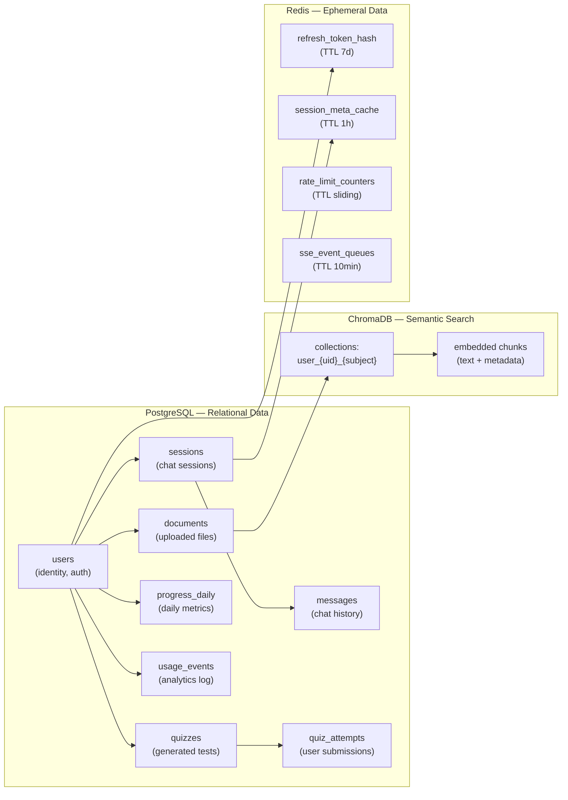
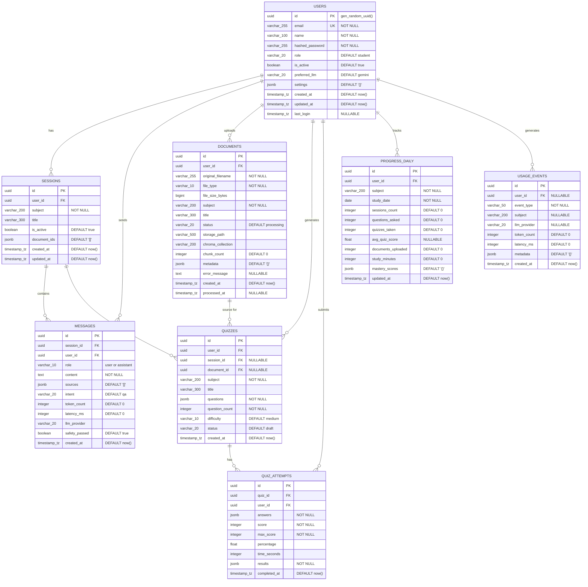

# EduNex AI — Database Design

> **Version:** 1.0  
> **Date:** 2026-11-12  
> **Database:** PostgreSQL 15 (primary) + ChromaDB (vector store)  
> **ORM:** SQLAlchemy 2.0 async + Alembic migrations

---

## Table of Contents
1. [Database Overview](#1-database-overview)
2. [PostgreSQL Schema](#2-postgresql-schema)
3. [Table Definitions](#3-table-definitions)
4. [Indexes & Constraints](#4-indexes--constraints)
5. [ChromaDB Collections Design](#5-chromadb-collections-design)
6. [Redis Schema](#6-redis-schema)
7. [Alembic Migration Strategy](#7-alembic-migration-strategy)
8. [SQLAlchemy ORM Models](#8-sqlalchemy-orm-models)
9. [Sample Queries](#9-sample-queries)

---

## 1. Database Overview



---

## 2. PostgreSQL Schema

### Complete ER Diagram



---

## 3. Table Definitions

### 3.1 `users`

```sql
CREATE TABLE users (
    id              UUID PRIMARY KEY DEFAULT gen_random_uuid(),
    email           VARCHAR(255) NOT NULL UNIQUE,
    name            VARCHAR(100) NOT NULL,
    hashed_password VARCHAR(255) NOT NULL,
    role            VARCHAR(20)  NOT NULL DEFAULT 'student'
                    CHECK (role IN ('student', 'admin')),
    is_active       BOOLEAN NOT NULL DEFAULT TRUE,
    preferred_llm   VARCHAR(20)  NOT NULL DEFAULT 'gemini'
                    CHECK (preferred_llm IN ('gemini', 'ollama')),
    settings        JSONB NOT NULL DEFAULT '{}',
    created_at      TIMESTAMPTZ NOT NULL DEFAULT NOW(),
    updated_at      TIMESTAMPTZ NOT NULL DEFAULT NOW(),
    last_login      TIMESTAMPTZ
);

COMMENT ON TABLE users IS 'Registered EduNex AI users';
COMMENT ON COLUMN users.hashed_password IS 'bcrypt hash, never plain text';
COMMENT ON COLUMN users.settings IS 'User preferences: theme, notifications, language';
```

### 3.2 `sessions`

```sql
CREATE TABLE sessions (
    id           UUID PRIMARY KEY DEFAULT gen_random_uuid(),
    user_id      UUID NOT NULL REFERENCES users(id) ON DELETE CASCADE,
    subject      VARCHAR(200) NOT NULL,
    title        VARCHAR(300),
    is_active    BOOLEAN NOT NULL DEFAULT TRUE,
    document_ids JSONB NOT NULL DEFAULT '[]',
    created_at   TIMESTAMPTZ NOT NULL DEFAULT NOW(),
    updated_at   TIMESTAMPTZ NOT NULL DEFAULT NOW()
);

COMMENT ON COLUMN sessions.document_ids IS 'Array of document UUIDs scoped to this session';
```

### 3.3 `messages`

```sql
CREATE TABLE messages (
    id            UUID PRIMARY KEY DEFAULT gen_random_uuid(),
    session_id    UUID NOT NULL REFERENCES sessions(id) ON DELETE CASCADE,
    user_id       UUID NOT NULL REFERENCES users(id) ON DELETE CASCADE,
    role          VARCHAR(10) NOT NULL CHECK (role IN ('user', 'assistant')),
    content       TEXT NOT NULL,
    sources       JSONB NOT NULL DEFAULT '[]',
    intent        VARCHAR(20) NOT NULL DEFAULT 'qa'
                  CHECK (intent IN ('qa', 'quiz', 'summarize', 'progress', 'auto')),
    token_count   INTEGER NOT NULL DEFAULT 0,
    latency_ms    INTEGER NOT NULL DEFAULT 0,
    llm_provider  VARCHAR(20),
    safety_passed BOOLEAN NOT NULL DEFAULT TRUE,
    created_at    TIMESTAMPTZ NOT NULL DEFAULT NOW()
);

COMMENT ON COLUMN messages.sources IS 'Array of {title, page, score, snippet} citation objects';
```

### 3.4 `documents`

```sql
CREATE TABLE documents (
    id                UUID PRIMARY KEY DEFAULT gen_random_uuid(),
    user_id           UUID NOT NULL REFERENCES users(id) ON DELETE CASCADE,
    original_filename VARCHAR(255) NOT NULL,
    file_type         VARCHAR(10) NOT NULL
                      CHECK (file_type IN ('pdf', 'png', 'jpg', 'jpeg', 'txt', 'md')),
    file_size_bytes   BIGINT,
    subject           VARCHAR(200) NOT NULL,
    title             VARCHAR(300),
    status            VARCHAR(20) NOT NULL DEFAULT 'processing'
                      CHECK (status IN ('processing', 'ready', 'failed')),
    storage_path      VARCHAR(500),
    chroma_collection VARCHAR(200),
    chunk_count       INTEGER NOT NULL DEFAULT 0,
    metadata          JSONB NOT NULL DEFAULT '{}',
    error_message     TEXT,
    created_at        TIMESTAMPTZ NOT NULL DEFAULT NOW(),
    processed_at      TIMESTAMPTZ
);
```

### 3.5 `quizzes`

```sql
CREATE TABLE quizzes (
    id             UUID PRIMARY KEY DEFAULT gen_random_uuid(),
    user_id        UUID NOT NULL REFERENCES users(id) ON DELETE CASCADE,
    session_id     UUID REFERENCES sessions(id) ON DELETE SET NULL,
    document_id    UUID REFERENCES documents(id) ON DELETE SET NULL,
    subject        VARCHAR(200) NOT NULL,
    title          VARCHAR(300),
    questions      JSONB NOT NULL,
    question_count INTEGER NOT NULL,
    difficulty     VARCHAR(10) NOT NULL DEFAULT 'medium'
                   CHECK (difficulty IN ('easy', 'medium', 'hard')),
    status         VARCHAR(20) NOT NULL DEFAULT 'ready'
                   CHECK (status IN ('generating', 'ready', 'failed')),
    created_at     TIMESTAMPTZ NOT NULL DEFAULT NOW()
);

COMMENT ON COLUMN quizzes.questions IS 'Array of QuizQuestion objects with answer + explanation';
```

### 3.6 `quiz_attempts`

```sql
CREATE TABLE quiz_attempts (
    id           UUID PRIMARY KEY DEFAULT gen_random_uuid(),
    quiz_id      UUID NOT NULL REFERENCES quizzes(id) ON DELETE CASCADE,
    user_id      UUID NOT NULL REFERENCES users(id) ON DELETE CASCADE,
    answers      JSONB NOT NULL,
    score        INTEGER NOT NULL,
    max_score    INTEGER NOT NULL,
    percentage   FLOAT GENERATED ALWAYS AS
                 (CASE WHEN max_score > 0 THEN (score::FLOAT / max_score) * 100 ELSE 0 END)
                 STORED,
    time_seconds INTEGER,
    results      JSONB NOT NULL,
    completed_at TIMESTAMPTZ NOT NULL DEFAULT NOW()
);
```

### 3.7 `progress_daily`

```sql
CREATE TABLE progress_daily (
    id                  UUID PRIMARY KEY DEFAULT gen_random_uuid(),
    user_id             UUID NOT NULL REFERENCES users(id) ON DELETE CASCADE,
    subject             VARCHAR(200) NOT NULL,
    study_date          DATE NOT NULL,
    sessions_count      INTEGER NOT NULL DEFAULT 0,
    questions_asked     INTEGER NOT NULL DEFAULT 0,
    quizzes_taken       INTEGER NOT NULL DEFAULT 0,
    avg_quiz_score      FLOAT,
    documents_uploaded  INTEGER NOT NULL DEFAULT 0,
    study_minutes       INTEGER NOT NULL DEFAULT 0,
    mastery_scores      JSONB NOT NULL DEFAULT '{}',
    updated_at          TIMESTAMPTZ NOT NULL DEFAULT NOW(),
    UNIQUE (user_id, subject, study_date)
);

COMMENT ON COLUMN progress_daily.mastery_scores IS
    'Per-topic mastery: {"Calculus": 85, "Algebra": 70}';
```

### 3.8 `usage_events`

```sql
CREATE TABLE usage_events (
    id           UUID PRIMARY KEY DEFAULT gen_random_uuid(),
    user_id      UUID REFERENCES users(id) ON DELETE SET NULL,
    event_type   VARCHAR(50) NOT NULL,
    subject      VARCHAR(200),
    llm_provider VARCHAR(20),
    token_count  INTEGER NOT NULL DEFAULT 0,
    latency_ms   INTEGER NOT NULL DEFAULT 0,
    metadata     JSONB NOT NULL DEFAULT '{}',
    created_at   TIMESTAMPTZ NOT NULL DEFAULT NOW()
);

COMMENT ON COLUMN usage_events.event_type IS
    'chat_message | quiz_generated | document_uploaded | summary | login';
```

---

## 4. Indexes & Constraints

```sql
-- Users
CREATE INDEX idx_users_email ON users (email);
CREATE INDEX idx_users_role ON users (role);

-- Sessions
CREATE INDEX idx_sessions_user_id ON sessions (user_id);
CREATE INDEX idx_sessions_user_active ON sessions (user_id, is_active);
CREATE INDEX idx_sessions_created_at ON sessions (created_at DESC);

-- Messages
CREATE INDEX idx_messages_session_id ON messages (session_id);
CREATE INDEX idx_messages_user_id ON messages (user_id);
CREATE INDEX idx_messages_created_at ON messages (session_id, created_at ASC);

-- Documents
CREATE INDEX idx_documents_user_id ON documents (user_id);
CREATE INDEX idx_documents_user_subject ON documents (user_id, subject);
CREATE INDEX idx_documents_status ON documents (user_id, status);

-- Quizzes
CREATE INDEX idx_quizzes_user_id ON quizzes (user_id);
CREATE INDEX idx_quizzes_subject ON quizzes (user_id, subject);

-- Quiz Attempts
CREATE INDEX idx_quiz_attempts_user ON quiz_attempts (user_id);
CREATE INDEX idx_quiz_attempts_quiz ON quiz_attempts (quiz_id);

-- Progress
CREATE INDEX idx_progress_user_date ON progress_daily (user_id, study_date DESC);
CREATE INDEX idx_progress_user_subject ON progress_daily (user_id, subject);

-- Usage Events
CREATE INDEX idx_usage_user_time ON usage_events (user_id, created_at DESC);
CREATE INDEX idx_usage_event_type ON usage_events (event_type, created_at DESC);

-- Auto-update updated_at trigger
CREATE OR REPLACE FUNCTION update_updated_at()
RETURNS TRIGGER AS $$
BEGIN
    NEW.updated_at = NOW();
    RETURN NEW;
END;
$$ LANGUAGE plpgsql;

CREATE TRIGGER trg_users_updated_at
    BEFORE UPDATE ON users
    FOR EACH ROW EXECUTE FUNCTION update_updated_at();

CREATE TRIGGER trg_sessions_updated_at
    BEFORE UPDATE ON sessions
    FOR EACH ROW EXECUTE FUNCTION update_updated_at();
```

---

## 5. ChromaDB Collections Design

### Collection Naming Strategy

```
user_{user_id}_{subject_slug}

Examples:
  user_abc123_mathematics
  user_abc123_physics
  user_abc123_all          ← cross-subject collection
```

### Document Chunk Metadata Schema

Each chunk stored in ChromaDB includes this metadata:

```json
{
  "doc_id": "uuid",
  "user_id": "uuid",
  "subject": "Physics",
  "title": "Thermodynamics Chapter 4",
  "filename": "thermo_ch4.pdf",
  "file_type": "pdf",
  "page_number": 12,
  "chunk_index": 3,
  "chunk_total": 42,
  "created_at": "2026-11-12T13:00:00Z"
}
```

### Query Pattern

```python
# rag/retriever.py

results = collection.query(
    query_embeddings=[query_embedding],   # 384-dim vector
    n_results=5,
    where={"doc_id": {"$in": document_ids}},  # Filter by selected docs
    include=["documents", "metadatas", "distances"]
)

# Apply threshold filter
chunks = [
    {"text": doc, "metadata": meta, "score": 1 - dist}
    for doc, meta, dist in zip(
        results["documents"][0],
        results["metadatas"][0],
        results["distances"][0]
    )
    if (1 - dist) >= SCORE_THRESHOLD  # 0.70
]
```

---

## 6. Redis Schema

| Key Pattern | Type | TTL | Purpose |
|-------------|------|-----|---------|
| `rt:{user_id}:{token_hash}` | String | 7 days | Refresh token validity |
| `rt_blocklist:{token_hash}` | String | 7 days | Revoked refresh tokens |
| `rate:{user_id}:{endpoint}` | Integer (INCR) | Sliding window | Rate limit counter |
| `rate:ip:{ip}:{endpoint}` | Integer (INCR) | Sliding window | IP rate limit |
| `sse:queue:{message_id}` | List (RPUSH/BLPOP) | 10 minutes | SSE event buffer |
| `session:meta:{session_id}` | Hash | 1 hour | Cached session metadata |
| `doc:status:{doc_id}` | String | 2 hours | Document processing status |

---

## 7. Alembic Migration Strategy

```
alembic/
├── versions/
│   ├── 001_create_users.py
│   ├── 002_create_sessions_messages.py
│   ├── 003_create_documents.py
│   ├── 004_create_quizzes.py
│   ├── 005_create_progress.py
│   ├── 006_create_usage_events.py
│   └── 007_add_indexes.py
└── env.py
```

**Migration command:**
```bash
alembic upgrade head          # Apply all migrations
alembic downgrade -1          # Roll back one version
alembic revision --autogenerate -m "add_field_x"  # Auto-generate from model changes
```

---

## 8. SQLAlchemy ORM Models

```python
# models/user.py
from sqlalchemy import String, Boolean, JSON, DateTime, func
from sqlalchemy.orm import DeclarativeBase, Mapped, mapped_column, relationship
from sqlalchemy.dialects.postgresql import UUID
import uuid

class Base(DeclarativeBase):
    pass

class User(Base):
    __tablename__ = "users"

    id: Mapped[uuid.UUID] = mapped_column(
        UUID(as_uuid=True), primary_key=True, default=uuid.uuid4
    )
    email: Mapped[str] = mapped_column(String(255), unique=True, nullable=False)
    name: Mapped[str] = mapped_column(String(100), nullable=False)
    hashed_password: Mapped[str] = mapped_column(String(255), nullable=False)
    role: Mapped[str] = mapped_column(String(20), default="student")
    is_active: Mapped[bool] = mapped_column(Boolean, default=True)
    preferred_llm: Mapped[str] = mapped_column(String(20), default="gemini")
    settings: Mapped[dict] = mapped_column(JSON, default=dict)
    created_at: Mapped[datetime] = mapped_column(DateTime(timezone=True), server_default=func.now())
    updated_at: Mapped[datetime] = mapped_column(DateTime(timezone=True), onupdate=func.now())
    last_login: Mapped[Optional[datetime]] = mapped_column(DateTime(timezone=True))

    # Relationships
    sessions: Mapped[list["Session"]] = relationship(back_populates="user", cascade="all, delete")
    documents: Mapped[list["Document"]] = relationship(back_populates="user", cascade="all, delete")
    quizzes: Mapped[list["Quiz"]] = relationship(back_populates="user", cascade="all, delete")
    progress: Mapped[list["ProgressDaily"]] = relationship(back_populates="user", cascade="all, delete")
```

---

## 9. Sample Queries

### Get user's recent chat history with sources
```sql
SELECT
    m.id,
    m.role,
    m.content,
    m.sources,
    m.intent,
    m.token_count,
    m.created_at
FROM messages m
JOIN sessions s ON m.session_id = s.id
WHERE s.user_id = :user_id
  AND s.id = :session_id
ORDER BY m.created_at ASC
LIMIT 50;
```

### Get 30-day learning progress by subject
```sql
SELECT
    subject,
    SUM(sessions_count)      AS total_sessions,
    SUM(questions_asked)     AS total_questions,
    SUM(quizzes_taken)       AS total_quizzes,
    AVG(avg_quiz_score)      AS avg_score,
    SUM(study_minutes)       AS total_minutes
FROM progress_daily
WHERE user_id = :user_id
  AND study_date >= CURRENT_DATE - INTERVAL '30 days'
GROUP BY subject
ORDER BY total_sessions DESC;
```

### Upsert daily progress (called after each session)
```sql
INSERT INTO progress_daily (
    user_id, subject, study_date, sessions_count, questions_asked,
    quizzes_taken, avg_quiz_score, documents_uploaded, study_minutes
)
VALUES (:uid, :subject, CURRENT_DATE, 1, :questions, 0, NULL, 0, :minutes)
ON CONFLICT (user_id, subject, study_date)
DO UPDATE SET
    sessions_count  = progress_daily.sessions_count + 1,
    questions_asked = progress_daily.questions_asked + EXCLUDED.questions_asked,
    study_minutes   = progress_daily.study_minutes + EXCLUDED.study_minutes,
    updated_at      = NOW();
```

### Platform analytics query (admin)
```sql
SELECT
    DATE_TRUNC('day', created_at) AS day,
    COUNT(DISTINCT user_id)       AS active_users,
    COUNT(*)                      AS total_events,
    SUM(token_count)              AS tokens_used
FROM usage_events
WHERE created_at >= NOW() - INTERVAL '30 days'
GROUP BY 1
ORDER BY 1;
```

