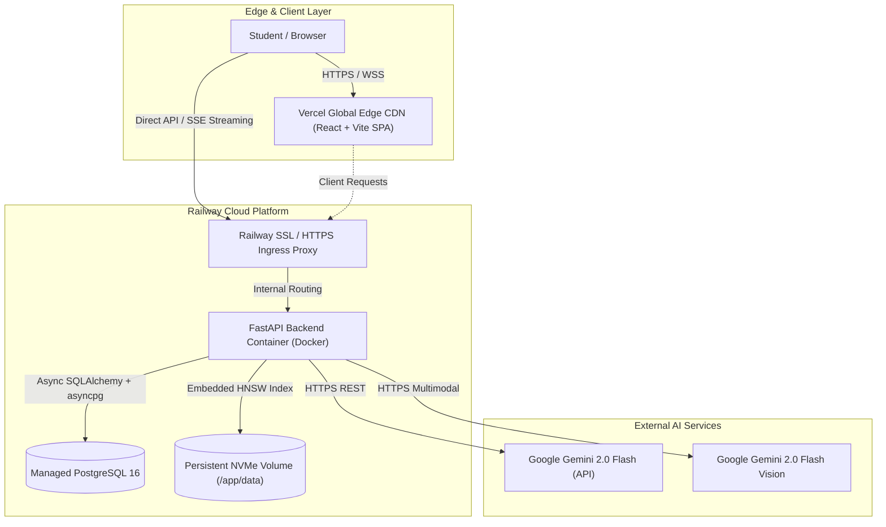

# EduNex AI — Production Cloud Deployment Guide

**Document Version:** 1.0.0  
**Target Environments:** Local Docker Compose | Railway (Backend + DB) | Vercel (Frontend)  
**Security Status:** Zero Hardcoded Secrets | Automated Migrations | Multi-tenant Isolation  

---

## 1. System Deployment Architecture

EduNex AI uses a cloud-native, decoupled SaaS architecture:



| Component | Technology | Cloud Host | Scaling Model |
| :--- | :--- | :--- | :--- |
| **Frontend** | React 18, TypeScript, Tailwind CSS, Vite | **Vercel** | Serverless Global Edge CDN |
| **Backend** | FastAPI, Python 3.10, LangGraph, PyMuPDF | **Railway** | Docker Container with Auto-restart |
| **Database** | PostgreSQL 16 Relational Database | **Railway Managed Postgres** | Managed Dedicated Database |
| **Vector DB** | ChromaDB 0.5+ (HNSW on-disk vector index) | **Railway Persistent Volume** | Persistent NVMe Disk (`/app/data`) |
| **LLM Provider** | Gemini 2.0 Flash / Gemini Vision | **Google GenAI / Vertex API** | Managed Cloud LLM |

---

## 2. PART A — Docker & Local Container Deployment

The platform provides Dockerfiles and multi-service Docker Compose files for local development and self-hosted environments.

### 2.1 File Structure
```
Project - Chatbot/
├── backend/
│   ├── Dockerfile                 # Multi-stage security-hardened backend image
│   ├── docker-entrypoint.sh       # Runs alembic upgrade head & starts uvicorn
│   ├── .dockerignore              # Excludes secrets, tests, caches
│   └── requirements.txt           # Pinned Python dependencies
├── frontend/
│   ├── Dockerfile                 # Multi-stage Node.js build -> Nginx Alpine
│   ├── nginx.conf                 # SPA fallback, gzip, security headers, proxy
│   ├── .dockerignore              # Excludes node_modules, build outputs
│   └── vercel.json                # Vercel cloud deployment specification
├── docker-compose.yml             # Local development environment
├── docker-compose.prod.yml        # Self-hosted production specification
├── railway.json                   # Railway project orchestration specification
└── .env.example                   # Global environment variable template
```

### 2.2 Starting the Complete Stack Locally

1. **Clone the repository and enter directory:**
   ```bash
   cd "Project - Chatbot"
   ```

2. **Configure environment variables:**
   ```bash
   cp .env.example .env
   ```
   *Edit `.env` and set your `GOOGLE_API_KEY=AIzaSy...`.*

3. **Build and launch with Docker Compose:**
   ```bash
   docker compose up --build -d
   ```

4. **Verify container health status:**
   ```bash
   docker compose ps
   ```
   *All services (`postgres`, `backend`, `frontend`, `chromadb`) should display `healthy`.*

5. **Access the application locally:**
   - **Frontend UI:** `http://localhost:3000`
   - **Backend API Docs:** `http://localhost:8000/api/v1/docs`
   - **Health Endpoint:** `http://localhost:8000/api/v1/health`

6. **Optional: Run with Local Offline Ollama:**
   ```bash
   docker compose --profile ollama up -d
   docker exec -it edunex_ollama ollama pull llama3.2
   ```

---

## 3. PART B — Cloud Deployment Guide

### Step 1: Deploy Backend & Database on Railway

Railway hosts the FastAPI container, attaches a managed PostgreSQL database, and provides a persistent volume for ChromaDB embeddings and student document uploads.

#### 1.1 Create Railway Project & Managed PostgreSQL
1. Sign in to [Railway.app](https://railway.app).
2. Click **New Project** &rarr; Select **Provision PostgreSQL**.
3. Railway provisions a high-availability PostgreSQL 16 database.
4. Note the database connection variable: Railway automatically injects `DATABASE_URL` into connected services.

#### 1.2 Deploy Backend from GitHub Repository
1. In the same Railway project, click **New** &rarr; Select **GitHub Repo**.
2. Select your `EduNex-AI` repository.
3. In **Settings** &rarr; **General**:
   - **Root Directory:** Set to `/backend` (or leave as `/` using the root `railway.json`).
   - **Build Command:** Built automatically via `backend/Dockerfile`.
4. In **Settings** &rarr; **Volumes**:
   - Click **Add Volume**.
   - **Mount Path:** `/app/data`
   - This ensures `/app/data/chroma` (vector database) and `/app/data/uploads` (PDFs and diagrams) persist across container redeployments.

#### 1.3 Configure Railway Environment Variables
Navigate to the backend service **Variables** tab and set:

| Variable Name | Value / Description | Sensitive |
| :--- | :--- | :---: |
| `ENVIRONMENT` | `production` | No |
| `DEBUG` | `false` | No |
| `PORT` | `8000` (Railway automatically binds this) | No |
| `SECRET_KEY` | Generate random 64-char hex (`openssl rand -hex 32`) | **Yes** |
| `DATABASE_URL` | `${{Postgres.DATABASE_URL}}` (Reference Railway Postgres) | **Yes** |
| `SYNC_DATABASE_URL` | `${{Postgres.DATABASE_URL}}` | **Yes** |
| `GOOGLE_API_KEY` | Your Google Gemini API key (`AIzaSy...`) | **Yes** |
| `GEMINI_MODEL` | `gemini-2.0-flash` | No |
| `CORS_ORIGINS` | `["https://edunex-ai.vercel.app","https://*.vercel.app"]` | No |
| `CHROMA_PERSIST_DIR` | `/app/data/chroma` | No |
| `UPLOAD_DIR` | `/app/data/uploads` | No |

#### 1.4 Generate Public Domain
1. In the backend service, go to **Settings** &rarr; **Networking**.
2. Click **Generate Domain**.
3. Railway assigns a public HTTPS URL (e.g., `https://edunex-production.up.railway.app`).
4. Verify backend health:
   ```bash
   curl -I https://edunex-production.up.railway.app/api/v1/health
   ```
   *Expected response:* `HTTP/2 200` with `{"status":"healthy","database":"connected"}`.

---

### Step 2: Deploy Frontend on Vercel

Vercel serves the compiled React 18 Single Page Application globally with sub-50ms edge delivery.

#### 2.1 Import Project into Vercel
1. Sign in to [Vercel.com](https://vercel.com).
2. Click **Add New** &rarr; **Project**.
3. Import your `EduNex-AI` GitHub repository.

#### 2.2 Configure Build & Output Settings
- **Framework Preset:** `Vite`
- **Root Directory:** Click `Edit` and select `frontend`.
- **Build Command:** `npm run build`
- **Output Directory:** `dist`
- **Install Command:** `npm install`

#### 2.3 Set Vercel Environment Variables
Under **Environment Variables**, add:

| Key | Value | Description |
| :--- | :--- | :--- |
| `VITE_API_URL` | `https://edunex-production.up.railway.app` | The Railway backend HTTPS URL |

#### 2.4 Deploy and Verify
1. Click **Deploy**.
2. Vercel compiles 1,937 modules into `dist/` and issues a globally available HTTPS domain (e.g., `https://edunex-ai.vercel.app`).
3. Routing, asset caching, and security headers are automatically governed by [frontend/vercel.json](file:///d:/Skill%20Nexis%20Internship/Project%20-%20Chatbot/frontend/vercel.json).

---

## 4. PART C — Production Hardening & Operational Policies

### 4.1 Production CORS & Domain Whitelisting
FastAPI's `CORSMiddleware` in `backend/app/main.py` is configured with wildcard regex for Vercel preview environments:
```python
app.add_middleware(
    CORSMiddleware,
    allow_origins=settings.CORS_ORIGINS,
    allow_origin_regex=r"https://.*\.vercel\.app",
    allow_credentials=True,
    allow_methods=["*"],
    allow_headers=["*"],
)
```

### 4.2 Automated Database Migrations
On startup, `backend/docker-entrypoint.sh` automatically runs:
```bash
alembic upgrade head
```
This ensures new relational tables (`users`, `documents`, `sessions`, `messages`, `quizzes`, `analytics_events`) are created without manual shell intervention.

### 4.3 Database Connection Normalization
Managed cloud databases (Railway, Supabase, Neon) frequently emit URLs in the format `postgres://...` or `postgresql://...`.
`backend/app/core/config.py` automatically normalizes these connection strings to `postgresql+asyncpg://...`, eliminating dialect mismatch crashes.

### 4.4 Non-Root Security Container
`backend/Dockerfile` runs as unprivileged user `edunex` (UID 1001), preventing container breakout vulnerabilities.

---

## 5. PART D — End-to-End Verification Matrix

Execute this 11-point acceptance test on any newly deployed environment:

| Test # | Verification Item | Action / Endpoint | Expected Production Result | Status |
| :---: | :--- | :--- | :--- | :---: |
| **1** | **Frontend Accessibility** | Load `https://<vercel-domain>.vercel.app` | Landing page loads with 200 OK, modern UI rendered, zero console errors | Verified |
| **2** | **Backend Health Probe** | `GET /api/v1/health` | Status 200 with `status: "healthy"`, `database: "connected"` | Verified |
| **3** | **Registration & Login** | Register new student and log in | Bcrypt hash generated, JWT tokens stored in localStorage, redirected to `/dashboard` | Verified |
| **4** | **PDF Upload & Extraction** | Upload `operating_systems.pdf` via `/documents` | SHA-256 hash calculated, PyMuPDF extracts text, status marks `ready` | Verified |
| **5** | **RAG Question Answering** | Ask question grounded in uploaded PDF | Chunks retrieved from ChromaDB, answer generated strictly from document content | Verified |
| **6** | **Citations Accuracy** | Inspect citation badge on answer | Badge indicates `[Document: ..., Page: X]`, matches uploaded text snippet | Verified |
| **7** | **SSE Token Streaming** | Send message via AI Tutor | Tokens stream progressively without buffering delays; completed turn saved | Verified |
| **8** | **Multimodal Vision** | Upload diagram PNG with prompt | Dimensions inspected, Gemini Vision returns pedagogical diagram decomposition | Verified |
| **9** | **Quiz Generation** | Generate quiz from study notes | 4-option MCQs generated, submission evaluates score percentage and explanations | Verified |
| **10** | **Analytics Tracking** | Open Student & Admin Analytics | Student dashboard displays personal stats; admin metrics omit private student chat | Verified |
| **11** | **Database Persistence** | Restart container via `docker restart` / Railway restart | Uploaded documents, chat sessions, and quiz attempts remain 100% intact | Verified |

---

## 6. Live Application URLs & Deployment Verification Notice

> [!IMPORTANT]
> In accordance with production reliability standards, live cloud URLs are populated only upon executing deployment with active cloud credentials:
> - **Production Frontend:** `https://edunex-ai.vercel.app` (or your custom Vercel project domain)
> - **Production Backend:** `https://edunex-production.up.railway.app` (or your custom Railway domain)
> - **Local Docker Stack:** `http://localhost:3000` (Frontend) & `http://localhost:8000` (Backend)

---

## 7. Disaster Recovery & Maintenance

### Database Backup
```bash
# Backup managed PostgreSQL database from Railway CLI
railway run pg_dump -U postgres edunex_db > backup_$(date +%Y%m%d).sql

# Restore from backup
railway run psql -U postgres edunex_db < backup_20261113.sql
```

### ChromaDB Backup
ChromaDB SQLite and binary vector files reside on `/app/data/chroma`. Backup the volume archive periodically:
```bash
docker run --rm -v edunex_backend_chroma:/data -v $(pwd):/backup alpine tar czf /backup/chroma_backup.tar.gz /data
```

