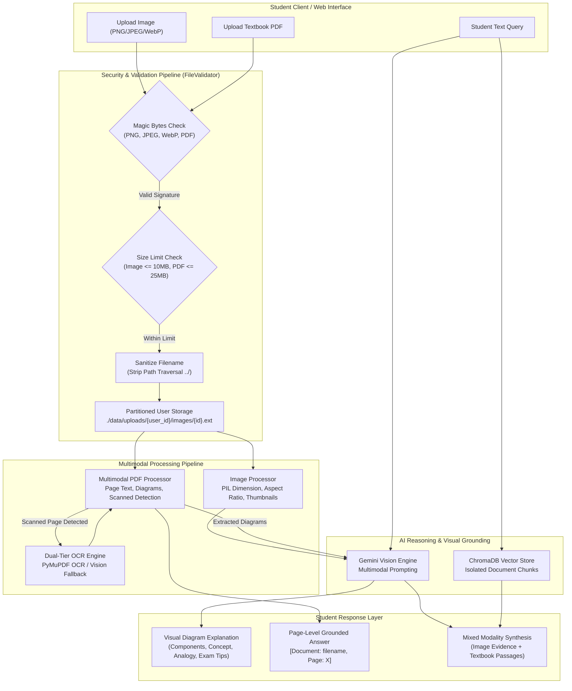

# EduNex AI — Multimodal Educational Assistant Specification

**Document Version:** 1.0.0  
**Status:** Approved & Verified  
**System Scope:** EduNex AI Multimodal Subsystem (`app/multimodal/`, `app/schemas/multimodal.py`, `app/api/routes/multimodal.py`)

---

## 1. Executive Summary & Vision

EduNex AI's multimodal educational architecture empowers students to interact naturally across visual, textual, and document modalities. Beyond standard text-based Q&A, students can:
1. Upload complex educational diagrams (architectural flowcharts, biological schematics, electronic circuits, network topologies) and receive structured pedagogical breakdowns.
2. Pose mathematical questions about formulas, geometric proofs, and coordinate plots, receiving LaTeX transcriptions and step-by-step derivations.
3. Ingest textbooks and lecture slides, preserving 1-indexed page citations, extracting embedded figures, and performing OCR on scanned pages without native text.
4. Issue **mixed queries** combining an uploaded image, a specific page of an academic PDF, and a student's natural language question.

---

## 2. Multimodal Architecture & Data Flow



---

## 3. Subsystem Components (`app/multimodal/`)

### 3.1 FileValidator (`app/multimodal/validator.py`)
- **Strict Magic Byte Validation**:
  - `PNG`: Requires header `\x89PNG\r\n\x1a\n`.
  - `JPEG`: Requires header `\xff\xd8\xff`.
  - `WebP`: Requires `RIFF` prefix and `WEBP` identifier at byte offset 8–12.
  - `PDF`: Requires header `%PDF-`.
- **Extension & MIME Consistency**: Rejects disguised executables, scripts (`.sh`, `.exe`, `.js`), or HTML files uploaded with spoofed extensions.
- **Path Traversal Protection**: Rejects or strips relative paths (`../`, `..\`) and replaces non-alphanumeric characters.
- **Size Enforcement**:
  - Educational Images: Maximum 10 MB (`MAX_IMAGE_UPLOAD_SIZE_BYTES`).
  - Educational Documents: Maximum 25 MB (`MAX_UPLOAD_SIZE_BYTES`).
- **User-Partitioned Storage**:
  - Directory template: `./data/uploads/{user_id}/images/{image_id}.{ext}`
  - Directory template: `./data/uploads/{user_id}/documents/{document_id}.pdf`

### 3.2 ImageProcessor (`app/multimodal/image_processor.py`)
- **PIL Header & Integrity Verification**: Uses `Image.verify()` and EXIF auto-rotation (`ImageOps.exif_transpose`).
- **Dimension Inspection & Safety Bounds**: Rejects images exceeding 4096px in either dimension to prevent decompression bombs.
- **Thumbnail Generation**: Automatically generates high-efficiency preview thumbnails (LANCZOS resampling, 400x400 max) for client-side rendering.
- **Data URI Helpers**: Converts binary images to base64 Data URIs (`data:image/png;base64,...`) for web embedding.

### 3.3 Dual-Tier OCR Engine (`app/multimodal/ocr_engine.py`)
- **Tier 1 (Local Engine)**: Leverages `pytesseract` or PyMuPDF's `Page.get_textpage_ocr()` when system libraries are configured.
- **Tier 2 (Gemini Vision OCR)**: When local Tesseract binaries are missing or for low-contrast handwriting/complex math formulas, routes rendered pixmaps to Gemini Vision.
- **Tier 3 (Visual Metadata Fallback)**: Extracts geometry, dimensions, and format headers for offline deterministic testing and resilience.

### 3.4 Multimodal PDF Processor (`app/multimodal/pdf_processor.py`)
- **1-Indexed Page Preservation**: Preserves exact 1-indexed page numbers across all operations for accurate student citations.
- **Diagram & Embedded Figure Extraction**:
  - Scans pages using `page.get_images(full=True)`.
  - Extracts raw figure streams via `doc.extract_image(xref)`.
  - Filters out tiny navigational icons (< 40x40px or < 1KB), retaining meaningful educational charts and diagrams.
- **Scanned Page Detection & OCR**:
  - Detects pages with fewer than 30 characters of native text (`MIN_TEXT_CHARS_FOR_NATIVE_PAGE`).
  - Automatically renders the page at 150 DPI and invokes OCR to extract text.
- **Targeted Page Inspection**:
  - `get_page_detail(pdf_bytes, page_number)` extracts the specific page's text, embedded diagrams, and high-resolution rendered preview bytes.

### 3.5 Vision Client (`app/multimodal/vision_client.py`)
- **Google Gemini 2.0 Flash Multimodal API**: Passes image bytes via `types.Part.from_bytes` and multi-turn prompt context.
- **Specialized Pedagogical Prompts**:
  - `DIAGRAM_SYSTEM_PROMPT`: Directs the model to identify diagram type, deconstruct labeled elements step-by-step, explain underlying principles with analogies, and provide exam-relevant takeaways.
  - `MATH_SYSTEM_PROMPT`: Instructs the model to transcribe formulas into LaTeX notation (`$...$` and `$$...$$`), explain geometric relations, provide derivations, and note computational applications.
- **Deterministic Offline Vision Mock**: Emits structured pedagogical analyses for diagrams and math illustrations when external cloud credentials are offline.

### 3.6 MultimodalService (`app/multimodal/service.py`)
- Central coordinator orchestrating database transactions, storage paths, vision reasoning, and document page retrieval.
- Enforces strict multi-tenant authorization: students can access only their own images and documents.

---

## 4. API Endpoints Specification

### 4.1 Image Upload
- **Endpoint**: `POST /api/v1/multimodal/upload-image`
- **Content-Type**: `multipart/form-data`
- **Request**: Form field `file` (PNG, JPEG, WebP)
- **Response**: `ApiResponse(data=ImageUploadResponse)`
```json
{
  "success": true,
  "message": "Educational image uploaded and processed successfully",
  "data": {
    "id": "7b3b9b42-1e9a-4e2e-9d0d-b4b1a41f6e21",
    "original_filename": "network_architecture.png",
    "file_type": "png",
    "mime_type": "image/png",
    "file_size_bytes": 145020,
    "width": 600,
    "height": 300,
    "storage_path": "./data/uploads/.../7b3b9b42-1e9a-4e2e-9d0d-b4b1a41f6e21.png",
    "extracted_text": "Client-Server Architecture\nFastAPI Server\nHTTP Request",
    "created_at": "2026-11-12T18:50:00Z"
  }
}
```

### 4.2 Image Explanation
- **Endpoint**: `POST /api/v1/multimodal/explain-image`
- **Content-Type**: `application/json`
- **Request Body**:
```json
{
  "image_id": "7b3b9b42-1e9a-4e2e-9d0d-b4b1a41f6e21",
  "question": "How does data flow between the client and server in this diagram?",
  "prompt_type": "diagram"
}
```
- **Response**: `ApiResponse(data=ImageExplainResponse)`
```json
{
  "success": true,
  "data": {
    "image_id": "7b3b9b42-1e9a-4e2e-9d0d-b4b1a41f6e21",
    "question": "How does data flow between the client and server in this diagram?",
    "explanation": "### Educational Diagram Explanation\n\n1. Visual Identification: Architectural schematic...",
    "diagram_type": "diagram",
    "extracted_text": "Client-Server Architecture...",
    "latency_ms": 420
  }
}
```

### 4.3 PDF Page-Specific Query
- **Endpoint**: `POST /api/v1/multimodal/pdf-page-query`
- **Content-Type**: `application/json`
- **Request Body**:
```json
{
  "document_id": "18cf702b-a37a-4c20-a616-d30d17da2018",
  "page_number": 2,
  "question": "What are the steps of the TCP three-way handshake explained on this page?",
  "include_diagrams": true
}
```
- **Response**: `ApiResponse(data=PDFPageQueryResponse)`
```json
{
  "success": true,
  "data": {
    "document_id": "18cf702b-a37a-4c20-a616-d30d17da2018",
    "document_name": "computer_networks.pdf",
    "page_number": 2,
    "question": "What are the steps of the TCP three-way handshake explained on this page?",
    "answer": "[Page-Level Citation: computer_networks.pdf, Page 2]\n\nBased on Page 2...",
    "page_text_snippet": "TCP Transmission Control Protocol provides reliable stream delivery...",
    "diagram_count": 1,
    "diagrams": [
      {
        "diagram_index": 1,
        "page": 2,
        "format": "png",
        "width": 640,
        "height": 380,
        "size_bytes": 48200,
        "description": "Diagram 1 on page 2 (640x380)"
      }
    ],
    "is_scanned_page": false,
    "ocr_applied": false,
    "citations": [
      {
        "document_id": "18cf702b-a37a-4c20-a616-d30d17da2018",
        "document_name": "computer_networks.pdf",
        "page": 2,
        "snippet": "TCP Transmission Control Protocol..."
      }
    ],
    "latency_ms": 315
  }
}
```

### 4.4 Mixed Input Query
- **Endpoint**: `POST /api/v1/multimodal/mixed-query`
- **Content-Type**: `application/json`
- **Request Body**:
```json
{
  "text_query": "Does the circuit diagram in my image match the resistor formula in Chapter 3?",
  "image_id": "7b3b9b42-1e9a-4e2e-9d0d-b4b1a41f6e21",
  "document_ids": ["18cf702b-a37a-4c20-a616-d30d17da2018"],
  "page_number": 3
}
```

---

## 5. Security & Multi-Tenancy Architecture

| Threat / Attack Vector | Defense Mechanism Implemented |
|---|---|
| **File Signature Spoofing (e.g. `.exe` renamed to `.png`)** | `FileValidator.detect_format_from_bytes()` inspects first 16 binary magic bytes; mismatches raise `InvalidFileSignatureError` (HTTP 400). |
| **Path Traversal Attacks (`../../etc/passwd`)** | `FileValidator.sanitize_filename()` rejects and strips directory traversal patterns, allowing only safe basenames. |
| **Storage Exhaustion / Decompression Bombs** | Strict size limits (10 MB for images, 25 MB for PDFs) and 4096px dimension checks in `ImageProcessor`. |
| **Cross-Tenant Unauthorized Access** | All database queries and filesystem lookups enforce `user_id == current_user.id`. Querying another user's image raises `ImageNotFoundError` (HTTP 404). |
| **Arbitrary Code Execution** | Files are never executed; stored under non-executable user partitions with sanitized UUID-based filenames. |

