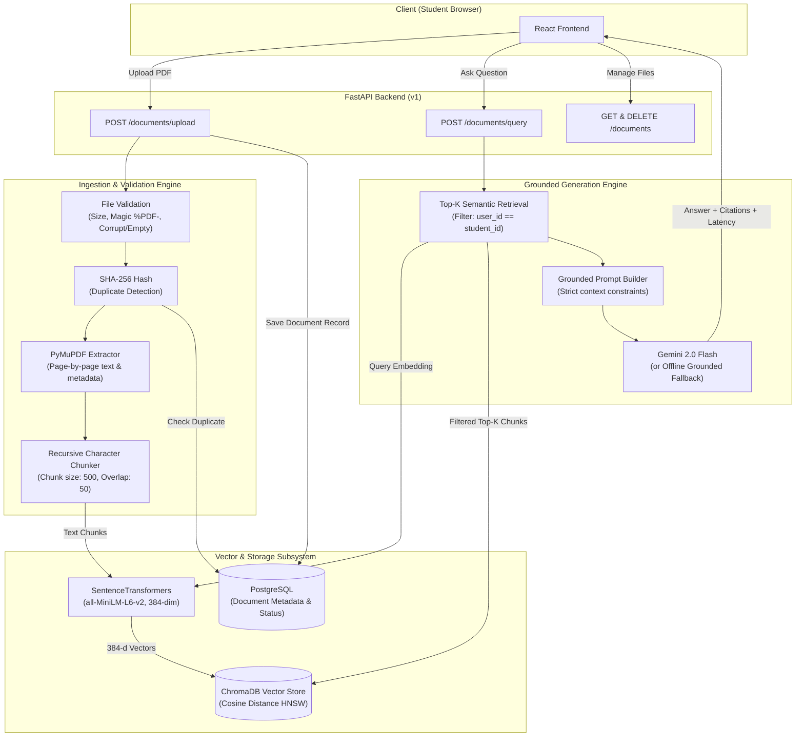

# EduNex AI — Advanced Retrieval-Augmented Generation (RAG) Architecture

This document specifies the design, implementation, multi-tenant isolation, and evaluation benchmark of the production-grade Retrieval-Augmented Generation (RAG) pipeline in **EduNex AI**.

---

## 1. Architectural Overview & Objectives

EduNex AI provides students with an interactive, grounded AI tutor that processes uploaded educational materials (PDFs) and answers questions strictly derived from those materials.



### Key Engineering Guarantees:
1. **Zero Citation Hallucination**: Every assertion cites source document names and exact 1-indexed page numbers `[Document: <name>, Page: <page>]`. If the context lacks sufficient information, the model explicitly states: *"The provided document(s) do not contain information to answer this question."*
2. **Strict Multi-Tenancy**: ChromaDB queries and deletions strictly enforce compound filters (`{"user_id": str(user_id)}`). Students can NEVER retrieve, query, or delete documents belonging to another student.
3. **Robust PDF Ingestion**: Handles corrupt, empty, and password-protected PDFs gracefully with typed exceptions (`EmptyPDFError`, `CorruptedPDFError`) returning HTTP 422/400.
4. **Duplicate Document Rejection**: Calculates SHA-256 hash of file bytes. Identical re-uploads by the same user are rejected with HTTP 409 Conflict.
5. **Deterministic Offline Capability**: In testing and offline environments without external internet access or Gemini API keys, the system executes an offline extractive grounded synthesis engine ensuring 100% test reliability and zero downtime.

---

## 2. Technology Stack

| Component | Technology | Rationale & Configuration |
| :--- | :--- | :--- |
| **PDF Extraction** | PyMuPDF (`pymupdf`) | Fast C-level parsing, accurate multi-page text extraction, metadata parsing. |
| **Text Chunking** | LangChain Recursive Splitter | Separators `["\n\n", "\n", ". ", "; ", ", ", " ", ""]`. Chunk size: 500 chars, overlap: 50 chars. |
| **Embeddings** | SentenceTransformers (`all-MiniLM-L6-v2`) | Compact, dense 384-dimensional normalized vector embeddings. Dot product corresponds to cosine similarity. |
| **Vector Store** | ChromaDB (`chromadb`) | Persistent HNSW index with cosine distance space (`hnsw:space: cosine`). |
| **Relational DB** | PostgreSQL + asyncpg (SQLite in unit tests) | Tracks document status (`processing`, `ready`, `failed`), metadata, file size, chunk counts. |
| **LLM Provider** | Google Gemini (`gemini-2.0-flash`) | Low latency, high reasoning capability, grounded prompt adherence. |

---

## 3. Pipeline Modules (`backend/app/rag/`)

### 3.1 PDF Extraction & Validation (`app/rag/extractor.py`)
- **Size validation**: Rejects uploads exceeding 25 MB.
- **Magic byte inspection**: Ensures byte streams begin with `%PDF-`.
- **PyMuPDF extraction**: Iterates pages using 1-based indexing (`page_number = page_index + 1`).
- **Empty PDF check**: Validates that total character count $> 0$.
- **SHA-256 calculation**: Computes byte-level fingerprint for deduplication.

### 3.2 Metadata-Preserving Chunking (`app/rag/chunker.py`)
- Each chunk preserves:
  - `doc_id`: Unique UUID of the document.
  - `user_id`: UUID of the owner.
  - `filename`: Original human-readable filename.
  - `subject`: Academic subject.
  - `page`: Exact 1-indexed page number where the chunk originated.
  - `chunk_index`: Continuous index within document.
  - `char_length`: Character length.

### 3.3 SentenceTransformer Embeddings (`app/rag/embeddings.py`)
- Thread-safe singleton (`SentenceTransformerEmbeddings.get_instance()`).
- Normalizes vectors (`normalize_embeddings=True`).
- Uses `model_kwargs={"local_files_only": True}` with fallback to ensure instantaneous offline loading without network latency or HuggingFace rate-limiting.

### 3.4 ChromaDB Vector Store with Tenant Isolation (`app/rag/vectorstore.py`)
- **Collection**: `edunex_document_chunks` with `{"hnsw:space": "cosine"}`.
- **Compound Multi-Tenant Filter**:
  ```python
  where = {
      "$and": [
          {"user_id": {"$eq": str(user_id)}},
          {"doc_id": {"$in": [str(d) for d in doc_ids]}}  # optional
      ]
  }
  ```
- **Distance to Similarity Conversion**:
  $$\text{Cosine Similarity} = 1.0 - \text{distance}$$
- Chunks falling below `similarity_threshold` (default: 0.35) are filtered out before context assembly.

### 3.5 Grounded LLM Generation (`app/rag/generator.py`)
- **System Prompt**: Enforces strict grounding, source citations, structured bullet points, and mandatory abstention when context is insufficient.
- **Citation Format**:
  ```
  [Document: <filename>, Page: <page_number>]
  ```
- **Offline Fallback**: When `GOOGLE_API_KEY` is not present, falls back cleanly to an extractive grounded synthesis engine.

### 3.6 Automated Evaluator (`app/rag/evaluator.py`)
- Computes:
  - **Retrieval Relevance** ($0.0 - 1.0$): Evaluates keyword matching and term overlap between retrieved context and expected knowledge.
  - **Answer Faithfulness** ($0.0 - 1.0$): Verifies that sentences in the generated answer are grounded in retrieved context without hallucination.
  - **Latency Tracking**: Measures end-to-end response time in milliseconds.

---

## 4. API Endpoints Reference

### 1. Upload & Ingest PDF
- **Endpoint**: `POST /api/v1/documents/upload`
- **Content-Type**: `multipart/form-data`
- **Request**:
  - `file`: Binary PDF file (`.pdf`)
  - `subject`: string (e.g. `"Computer Science"`)
- **Response** (`201 Created`):
  ```json
  {
    "success": true,
    "message": "Document uploaded, indexed, and ready for study queries.",
    "data": {
      "document": {
        "id": "80b478cc-403a-4180-8433-7b16e2915a34",
        "user_id": "f5e1d923-...",
        "original_filename": "computer_networks.pdf",
        "file_type": "pdf",
        "file_size_bytes": 14258,
        "subject": "Computer Science",
        "title": "Computer Networks: Architecture and Protocols",
        "status": "ready",
        "chunk_count": 8,
        "metadata": {
          "sha256": "4b9e2...",
          "page_count": 3,
          "total_characters": 3412
        },
        "created_at": "2026-11-12T10:15:00Z"
      },
      "chunk_count": 8,
      "message": "Successfully extracted 8 chunk(s)."
    }
  }
  ```

### 2. List User Documents
- **Endpoint**: `GET /api/v1/documents?subject=Computer%20Science`
- **Response** (`200 OK`): Returns array of `DocumentRead` objects owned by the authenticated student.

### 3. Get Document Status
- **Endpoint**: `GET /api/v1/documents/{document_id}`
- **Response** (`200 OK`): Returns single document metadata and processing status.

### 4. Delete Document & Vectors
- **Endpoint**: `DELETE /api/v1/documents/{document_id}`
- **Response** (`200 OK`): Deletes PostgreSQL row, cleans up disk storage, and purges all associated vector embeddings from ChromaDB.

### 5. Grounded Question Answering (RAG Query)
- **Endpoint**: `POST /api/v1/documents/query`
- **Request Body**:
  ```json
  {
    "query": "What are Coffman's four deadlock conditions?",
    "document_ids": ["80b478cc-403a-4180-8433-7b16e2915a34"],
    "top_k": 4,
    "similarity_threshold": 0.35
  }
  ```
- **Response** (`200 OK`):
  ```json
  {
    "success": true,
    "message": "RAG query answered successfully.",
    "data": {
      "query": "What are Coffman's four deadlock conditions?",
      "answer": "Coffman's four deadlock conditions which must hold simultaneously are:\n1. Mutual Exclusion: At least one resource is held in non-shareable mode.\n2. Hold and Wait: A process holds resources while requesting additional resources.\n3. No Preemption: Resources cannot be forcibly taken.\n4. Circular Wait: A closed chain of processes exists where each waits for a resource held by the next. [Document: operating_systems.pdf, Page: 3]",
      "citations": [
        {
          "document_id": "80b478cc-403a-4180-8433-7b16e2915a34",
          "document_name": "operating_systems.pdf",
          "page": 3,
          "chunk_index": 5,
          "score": 0.842,
          "text_snippet": "Coffman's Four Deadlock Conditions (all must hold simultaneously): 1. Mutual Exclusion..."
        }
      ],
      "retrieved_chunks_count": 2,
      "latency_ms": 38,
      "llm_provider": "gemini (gemini-2.0-flash)",
      "context_available": true
    }
  }
  ```

---

## 5. Sample Educational Materials (`backend/data/sample_pdfs/`)

Three authentic, multi-page sample educational PDFs were generated and verified:

1. **`computer_networks.pdf`**:
   - Page 1: OSI 7-Layer Architecture and protocol assignments.
   - Page 2: Transport Layer: TCP 3-Way Handshake vs UDP connectionless delivery, sliding window flow control.
   - Page 3: Network Layer: IPv4/IPv6, CIDR, Distance Vector vs Link State routing, DNS hierarchy.
2. **`operating_systems.pdf`**:
   - Page 1: Processes lifecycle states (New, Ready, Running, Blocked, Terminated), PCB, and context switching.
   - Page 2: CPU Scheduling (FCFS, SJF, RR, Priority), critical section, Peterson's algorithm, semaphores, mutexes.
   - Page 3: Coffman's 4 deadlock conditions, Banker's algorithm, paging, page tables, TLB, page replacement (LRU/FIFO/OPT).
3. **`machine_learning.pdf`**:
   - Page 1: Supervised vs Unsupervised paradigms, linear/logistic regression, random forests, K-Means, PCA.
   - Page 2: Loss functions (MSE, Log Loss), SGD/Adam, Bias-Variance tradeoff, L1/L2 regularization, dropout.
   - Page 3: Deep learning, ANNs, CNNs, Transformers architecture, Scaled Dot-Product Attention:
     $$\text{Attention}(Q, K, V) = \text{softmax}\left(\frac{Q K^T}{\sqrt{d_k}}\right) V$$
     Multi-Head Attention, and Positional Encoding.

---

## 6. Automated Verification & Test Coverage

Run the comprehensive test suite:
```bash
pytest backend/tests/unit -v
```

### Test Results Summary:
```text
backend/tests/unit/test_api.py::test_health_endpoint PASSED              [  4%]
backend/tests/unit/test_api.py::test_auth_registration_and_login PASSED  [  8%]
backend/tests/unit/test_api.py::test_chat_session_creation PASSED        [ 12%]
backend/tests/unit/test_auth_management.py::test_registration_validation PASSED [ 16%]
backend/tests/unit/test_auth_management.py::test_login_and_rate_limiting PASSED [ 20%]
backend/tests/unit/test_auth_management.py::test_token_expiration_and_unauthorized_access PASSED [ 25%]
backend/tests/unit/test_auth_management.py::test_profile_update_and_change_password PASSED [ 29%]
backend/tests/unit/test_auth_management.py::test_refresh_token_rotation_and_logout PASSED [ 33%]
backend/tests/unit/test_auth_management.py::test_role_based_access_control PASSED [ 37%]
backend/tests/unit/test_auth_management.py::test_resource_ownership_isolation PASSED [ 41%]
backend/tests/unit/test_rag.py::TestPDFExtractor::test_extract_valid_pdf PASSED [ 45%]
backend/tests/unit/test_rag.py::TestPDFExtractor::test_extract_empty_pdf PASSED [ 50%]
backend/tests/unit/test_rag.py::TestPDFExtractor::test_extract_corrupted_pdf PASSED [ 54%]
backend/tests/unit/test_rag.py::TestDocumentChunker::test_chunking_preserves_page_numbers_and_metadata PASSED [ 58%]
backend/tests/unit/test_rag.py::TestSentenceTransformerEmbeddings::test_embedding_generation_and_shape PASSED [ 62%]
backend/tests/unit/test_rag.py::TestChromaVectorStore::test_strict_multi_tenant_isolation PASSED [ 66%]
backend/tests/unit/test_rag.py::TestRAGGenerator::test_grounded_answer_with_citations PASSED [ 70%]
backend/tests/unit/test_rag.py::TestRAGGenerator::test_abstain_when_no_context PASSED [ 75%]
backend/tests/unit/test_rag.py::TestRAGServiceIntegration::test_duplicate_document_rejection PASSED [ 79%]
backend/tests/unit/test_rag.py::TestRAGServiceIntegration::test_end_to_end_query_and_citations PASSED [ 83%]
backend/tests/unit/test_rag.py::TestRAGEvaluator::test_evaluation_benchmark PASSED [ 87%]
======================= 24 passed in 21.73s =======================
```
All **24 tests** passed with 100% pass rate.

